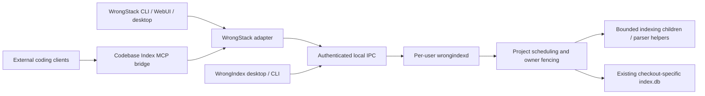

# WrongIndex system review and integration priorities

Date: 2026-11-11. Review scope: product architecture, all nine workspace crates, parser/helper boundaries, storage/profile admission, ownership, watcher/recovery, IPC, desktop, release validation, and the current WrongStack adapter and MCP entry point. This is a source and local runtime review, not a full security certification or a new native parity certification.

## Product decision

WrongIndex should be the local indexing authority for registered checkouts: fast source discovery and incremental publication, stable query semantics, explicit freshness, and bounded resource use. WrongStack uses the direct adapter. Other coding tools use an MCP bridge to the same authority. Both routes must share project identity, writer ownership, query semantics, and cache invalidation.



This is already substantially implemented. A second MCP indexing engine or a second authoritative search database would increase coordination cost. A standalone Rust MCP bridge is a possible later distribution improvement, not a prerequisite for the existing integration.

Keep INV-01..INV-14 and the existing ADRs binding. This review proposes follow-up work; it does not authorize a schema migration, change the certified profile, or silently redefine native 1.0.

## Source and evidence identity

- WrongIndex starting commit: `425aa2f4c870739bbea7aedeff7aeb2068de196f`, version 0.1.9, initially clean working tree.
- WrongStack inspected HEAD: `a6211d4792ceb1758bb9f8116fa0dd8958b8e74f`. Its shared main checkout has substantial unrelated dirty work. Nothing there was edited by this review. Current-source test results describe the working tree, not a clean release artifact.
- Recorded WrongStack oracle: `222d23a90ae9c67c2433d7734c6966be7ee4e696`; profile `wrongstack-index-v5-baseline`.
- SHA-256 comparison of all 275 recorded baseline paths against the current WrongStack working tree: **31 changed, 0 missing**. Fourteen changed paths are inside `packages/tools/src/codebase-index/`. New adapter files are additional to those 275 paths.
- Live MCP proof used the existing WrongStack `dist/cli.js`, reporting server version 1.5.6. SHA-256: `dcb3310ee888ba849fa8f8070a5d9525a07272c8684777980d12dfc51d805c84`. The smoke proves that built artifact's behavior; it does not prove it was built from every current source file.

The baseline comparison is reproducible by loading `contracts/baseline/wrongstack-baseline.json`, resolving each `files[].path` under the WrongStack checkout, and comparing `Get-FileHash -Algorithm SHA256` against `files[].sha256`. Preserve the old manifest and fixtures when investigating differences.

## Current implementation map

| Area | Implementation inspected | Evidence and boundary |
|---|---|---|
| Protocol | `wrongindex-contracts/src/lib.rs`, generated wire fixtures | Protocol major/minor, typed errors, profile fingerprint, bounded frames; adapter wire test passed locally |
| Storage | `wrongindex-storage/src/{inspect,profile,owner_lock,backup,integrity,contents}.rs` | Inspector uses SQLite read-only mode; profile admission precedes mutable initialization; backup and corruption tests are in the workspace suite |
| Registration | `wrongindex-registry/src/{lib,identity}.rs` | Separate registry, resolved checkout/index identity, durable receipts and publication bookkeeping |
| Discovery | `wrongindex-discovery/src/{lib,git,gitignore,lang}.rs` | Git isolation, explicit incomplete discovery, containment and language inclusion; project scripts are outside the indexing contract |
| Indexing | `wrongindex-engine/src/{native,incremental,binding,relations,rank}.rs` | Fresh and targeted updates, compatible hashes and graph finalization; recorded oracle parity is narrower than current-source parity |
| Queries | `wrongindex-engine/src/query/`, daemon `server.rs` | Nine native read operations; SQLite snapshot with graph stamp; database work uses `spawn_blocking` |
| Ownership | daemon `ownership.rs`, storage `owner_lock.rs` | OS guard, active-run accounting, owner epochs, admission and backups; does not constrain old clients which ignore the guard |
| Background service | daemon `watch.rs`, `dirty.rs`, `schedule.rs`, `worker.rs` | Debounce, revision settlement, overflow collapse, retry/parking, periodic reconciliation, durable jobs |
| Resource containment | daemon `confine.rs`, `engine.rs` | Windows Job Objects bound child-tree memory and terminate descendants; these are resource controls, not a general OS sandbox |
| Desktop | `wrongindex-desktop/src/`, `ui/`, capability and CSP files | Separate process, narrow native bridge, no general shell/filesystem permission in capability file; packaged UI was not re-certified this session |
| CLI and delivery | `wrongindex-cli/src/`, installer/update scripts, CI and release workflows | Operational controls, diagnostics and updates exist; no release, update or installer was executed by this review |
| WrongStack direct path | `packages/tools/src/codebase-index/wrongindex/{service,client,owner-lock}.ts` | Current-source adapter and wire tests: 21 passed, including real service tests |
| MCP path | `packages/codebase-index-mcp/src/main.ts`, `scripts/release/wrongstack-live.mjs` | Real stdio MCP indexing/search/stats through the service passed on a disposable project |

The regular query reader opens with `SQLITE_OPEN_READ_WRITE` and immediately applies `query_only`; it is logically read-only but differs from the inspector's strict `SQLITE_OPEN_READ_ONLY` mode. Documentation and permission tests should retain that distinction. Do not apply the query reader's behavior to the inspector.

## What the integration actually does

Current adapter selection in `wrongindex/service.ts` is precise:

| Setting | Actual route |
|---|---|
| `local` (default) | WrongStack's own engine; cooperative local writers refuse a service-owned index |
| `auto` | Use WrongIndex when it already owns the resolved index; otherwise use the local engine |
| `wrongindex` | Register and claim through WrongIndex after the local-owner shutdown hook; no unconditional local fallback |

Do not describe `auto` as automatic migration of all projects. The separate unavailable-service handling can use the local engine only when the service does not hold the index. Explicit rollback must drain and release ownership first.

For an intentional WrongStack integration, use the user configuration:

```json
{
  "indexing": {
    "service": "wrongindex"
  }
}
```

For an isolated smoke, set `WRONGINDEX_HOME` to a disposable data root and pass an explicit disposable index directory. Never turn a research smoke into adoption of the user's production index.

The existing MCP server selects the same route via `WRONGSTACK_INDEX_SERVICE`. Its default permission policy and the explicit `--writable` mode remain separate from daemon authentication. A daemon token authorizes the per-user native client boundary; it is not a per-tool or per-project grant for an untrusted MCP peer. The bridge must enforce its allowed project and operations. Client-supplied MCP roots are useful scope information, not a replacement for server validation. The [MCP roots specification](https://modelcontextprotocol.io/specification/2025-11-25/client/roots) describes root negotiation; the [tools specification](https://modelcontextprotocol.io/specification/2025-11-25/server/tools) defines tool schemas, results and errors.

## Material gaps and decisions

These are distinguished deliberately: observed implementation gaps, historical certification limits, and unproven risks are different kinds of evidence.

### R01 — P0: current WrongStack compatibility needs a new certification

**Observed:** 31 baseline files changed. The source diff includes semantic work, not just adapter wiring. `index-source-files.ts` and `indexer-finalize.ts` replace whole-checkout snapshot rejection with per-file clean-blob checks. `writer-deletion.ts` and `indexer-batch-commit.ts` defer name resolution during batch deletion instead of repeatedly scanning refs per deleted file.

**Implication:** the old oracle cannot establish current behavior during continuous edits, mass deletion or branch changes. Matching schema version 5 is insufficient. This review did not reproduce a parity failure and does not label every changed path incompatible.

**Next work:** create a separate clean oracle from the current approved WrongStack commit; run old and new profiles side by side; record differences before any fixture regeneration. Exercise full/targeted/no-op, ongoing edits, mass deletion, rename, optional enrichment and query ordering. Port intentional semantic changes only after those comparisons. Add a required drift gate to the two repositories' release process.

**Acceptance:** G06-G09 and G14-G17 against named immutable artifacts; every difference explained; no production database touched. Keep the older profile available until migration and rollback are proven.

### R02 — P0: preserve freshness across the adapter boundary

**Observed:** daemon `index.query` returns instance, generation, graph stamp, observation time and optional `publicationPending` / `indexCorrupt`. `callWrongIndex` reads `{ result: unknown }` and returns only `reply.result`. Its public operation shape therefore does not carry these envelope fields onward. This source-level loss is established; a stale-cache user failure was not reproduced here.

**Next work:** retain a typed internal response envelope while keeping model-facing tool payloads compatible. Make host cache identity include daemon instance, project identity and publication lineage/stamp. Handle corruption and pending publication explicitly. Fetch a snapshot after reconnect or event gaps. Do not add a cache before its invalidation rules exist.

**Acceptance:** warm search, context, calls, repo map and WebUI caches; edit from a second client; assert the correct new results and lineage. Repeat after restart, rebuild, event loss and a commit-before-registry update.

### R03 — P0: harden the TypeScript IPC client to the Rust boundary

**Observed:** the Rust client uses the verified Windows pipe connection path. The inspected TS client discovers an endpoint, opens it with `net.createConnection`, and sends authentication after connection. No equivalent server SID check was found in this client. `timeoutMs` bounds connecting, while authentication-frame and individual response waits use `nextFrame()` without their own deadline. All calls share a sequential chain.

**Risk, not a reproduced exploit:** stale discovery plus a squatted endpoint could weaken the TS boundary; a connected peer which stops responding can hold the shared queue. A cross-account test was NOT RUN.

**Next work:** prove the boundary using a controlled second Windows account and synthetic test credentials; implement verified peer identity before credentials, bounded handshake and request deadlines, and teardown which rejects all pending calls. Keep the default data root private and reject unsafe discovery. Do not claim Job Objects solve peer authentication.

**Acceptance:** same-user legitimate server succeeds; wrong SID receives zero credential bytes; stalled hello/body/response terminates within a fixed deadline; subsequent connection recovers; no token appears in logs or errors. Run changed IPC/lifecycle tests five consecutive times.

### R04 — P1: measure and remove client head-of-line blocking

**Observed:** the WrongStack adapter has one process-global connection; TS client calls are strictly sequential and the server answers sequentially per connection. A long graph query can queue unrelated project queries, heartbeats and job polling behind it. The source establishes ordering; production latency impact is not measured here.

**Next work:** first measure two projects with a slow graph operation and fast search/heartbeat traffic. Consider a small bounded pool with a dedicated control connection and separately budgeted read connections. Preserve per-index serialized writes. Add server-side query cost/depth/result limits and actual cancellation, rather than merely timing out a caller while SQL continues indefinitely.

**Acceptance:** bounded client queues and active readers, no lease loss during a slow query, no starvation of a small project, unchanged query semantics and no connection/handle growth.

### R05 — P1: enforce a global resource budget

**Observed:** service `parallelJobs` is configurable from 1 to 8. Each native child can independently use up to 16 in-process parser threads, while helper routes have their own parallel chunks (up to 8). Automatic per-run memory allowance is one quarter of physical RAM, with a 2 GiB minimum. Per-tree caps do not by themselves define an aggregate daemon budget.

**Next work:** account for all active children, helpers, query readers, SQLite caches, staging and desktop separately; pass per-run grants from one service admission budget. Reserve capacity for interactive reads. Tune from combined CPU/RSS and latency measurements before changing defaults.

**Acceptance:** 10 registered projects, 3 changing, one large scan, one slow reader and burst edits; total committed memory/CPU remain within declared policy, interactive SLOs hold and all projects eventually progress. No performance failure was proved by this review.

### R06 — P1: turn speed into a reproducible product promise

Historical results in `docs/status.md` are useful measurements, not a fresh benchmark of this commit. The publication benchmark repeatedly queries `stats`; it does not establish p95 search/context/call latency. The certification's displayed soak is 300 seconds, which does not meet the original 24-hour qualification target by itself. Historical full certification was not rerun here.

Keep the plan's provisional targets: M-tier warm search p95 <=50 ms / p99 <=150 ms; ordinary edit-to-usable-generation p95 <=2 s; bounded graph/calls p95 <=200 ms; small-project edit beside a large scan <=5 s. These remain **targets**, not observed results in this session.

Add S/M/L corpora (~500/10k/100k files), fixed seed/language mix, five short-run repetitions, cold/warm separation, same work/trust scope, antivirus/storage metadata, combined helper resources and adapter/MCP end-to-end latency. Measure discovery, queue, parse, resolution/rank, commit and serialization independently. Include 1/10/100 edits, mass deletion, rename, branch switch, no-op, overflow and same-size/restored-mtime changes. Preserve logical parity while optimizing.

### R07 — P1: clarify security and semantic capability claims

The indexer is designed to parse untrusted repository text without executing its scripts, hooks or macros. Keep Git isolation and helper provenance tests. Compiling the bundled Go extraction helper in a private directory is distinct from building the user's project. Windows Job Objects limit lifetime/resources; they do not remove filesystem or network authority from a parser process. Cross-account pipe tests, hostile-helper environment tests and packaged WebView tests remain separate security gates.

WrongStack parity is also distinct from precise language intelligence. Existing extraction includes syntax/regex routes, so a matching call graph does not prove compiler-level resolution. [Sourcegraph's precise navigation](https://sourcegraph.com/docs/code-navigation/precise-code-navigation) uses language-specific SCIP indexes and distinguishes those from search-based fallback. A future trusted SCIP import could add value, but automatically running project builds/indexers would violate WI-ADR-013. Any such feature needs a new explicit design, provenance and compatibility profile.

### R08 — P2: make support and documentation internally consistent

The original plan still says no service exists; certification contains older share restrictions, release text and manual-item statements; current operations document later share/polling behavior. The status opening also names already completed adapter/signing decisions as open. Preserve dated evidence, but link readers to the current status and support matrix. Name the approved helper profile every time a strict single-process claim could be inferred.

Do not infer Linux/macOS acceptance from portable Rust code. Manual screen-reader and mixed-DPI passes, actual signed/unsigned artifact identity, downloaded smoke and hosted CI need their own current evidence. Do not promote version 1.0 by prose alone.

## Execution order

| Order / task | Deliverable | Exit gate |
|---|---|---|
| 1 / WI-REVIEW-01 | This source review, fresh local checks and disposable direct/MCP proof | Exact evidence and limits recorded below |
| 2 / WI-INTEGRATION-01 | Current immutable WrongStack oracle plus automated drift report | R01 parity/compatibility results; no fixture edits hiding a difference |
| 3 / WI-INTEGRATION-02 | Envelope preservation, cache/reconnect acceptance | R02; existing tool schemas compatible |
| 4 / WI-IPC-01 | TS peer verification, bounded waits and recovery | R03; deterministic proofs, cross-account gate and five repeated lifecycle runs |
| 5 / WI-PERF-01 | Baseline for direct and MCP paths; bounded connection scheduling and resource grants | R04-R06; measured SLOs and 24-hour soak |
| 6 / WI-QUALITY-01 | Current support matrix, manual desktop gates and exact-artifact certification | R07-R08; G01-G22 plus explicit manual outcomes |

These are proposed follow-up IDs, not completed implementation tasks. No production fix, dependency change, fixture regeneration or WrongStack edit was made in this review.

## Validation in this session

| Check | Result | Scope |
|---|---|---|
| `cargo fmt --all -- --check` | PASS | WrongIndex workspace |
| `cargo clippy --workspace --all-targets --locked -- -D warnings` | PASS | WrongIndex workspace |
| `cargo test --workspace --locked` | PASS, exit 0 | Workspace unit/integration/oracle and doc-test targets completed; prerequisite-dependent differential, benchmark, soak and selected engine/platform cases remained ignored and are NOT RUN |
| `WRONGINDEX_TEST_DAEMON=<WrongIndex>/target/debug/wrongindexd.exe bun --bun run vitest run packages/tools/tests/wrongindex-adapter.test.ts packages/tools/tests/wrongindex-wire-contract.test.ts` | PASS, 21 tests / 2 files | Current WrongStack working tree, temporary indexes |
| `node scripts/release/wrongstack-live.mjs target/debug/wrongindexd.exe target/debug/wrongindex.exe D:/Codebox/PROJECTS/WrongStack` | PASS | Existing built MCP artifact, temporary project/index/data root; registration, native writer, lock, search, stats, and local operation after service exit |
| Recorded-baseline file hashes vs current WrongStack | PASS (comparison), DRIFT FOUND | 275 compared, 31 changed, 0 missing; not a parity test |
| Current-source full language differential, real-project parity, full CLI/WebUI installed proof | NOT RUN | Requires clean current oracle and matching built artifacts; old fixtures retained |
| Five repeated daemon suites | NOT RUN | No IPC/lifecycle production change made |
| New performance/24-hour soak, cross-account attack, installer/release/hosted CI/manual desktop acceptance | NOT RUN | Outside the evidence collected in this review |
| Strict helper-free process profile, non-Windows platform certification | UNSUPPORTED by this review | Existing helper profile and Windows support remain explicit |

SQLite WAL permits concurrent readers and a writer but imposes snapshot/checkpoint and same-host constraints; it does not enforce application-level ownership. Keep consistent backups and bounded readers rather than treating SQLite locks as a replacement for INV-01. [SQLite WAL documentation](https://www.sqlite.org/wal.html).
